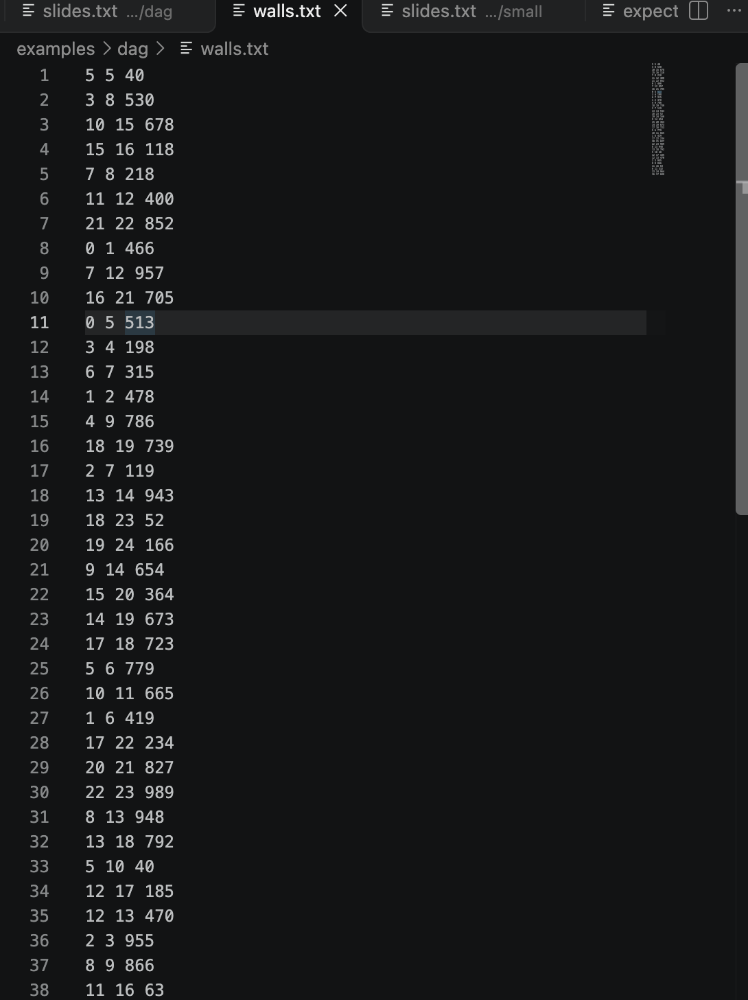
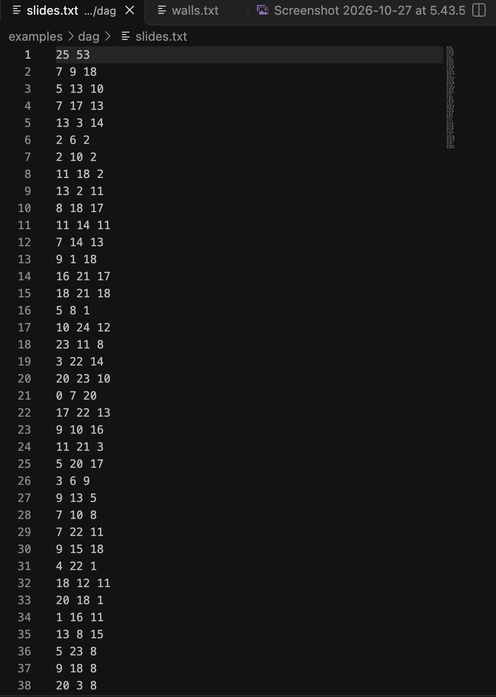

# Assignment 3. Maze Escape

Student ID: 254430
Name: Darkhan
Group: SE-2540.
Maze size (rows x columns): 8*9

This file is the report. Fill it in as you go. How to start: `START_HERE.md`. The task: `docs/Assignment3.pdf`.

## Program output

1. java -cp out Main
2. java tools/Check.java

The 13 lines your program prints on your data (`java -cp out Main`):

    Broken: 71
    Kept: 56
    Last broken wall: 96
    MST cost: 21998
    Heaviest broken wall: 738
    Path length: 21
    DFS visited: 64
    Dead ends: 23
    Zones: 9
    Largest zone: 15
    Is DAG: 0
    Flow stages: 6
    Fastest route cost: 22

My maze:

used "java tools/MakeVariant.java 254430 data" to generate data in "walls.txt" and "walls.txt".

slides:

walls:

## Questions

Mission 0. find locates the root of an element, while union merges two sets together. They run extremely fast due to path compression and union by size.

Mission 1. A maze with R * C cells is a spanning tree, which always requires removing R*C-1 walls to connect all cells without cycles. The remaining (R-1)(C-1) internal walls are kept.

Mission 2. Both Kruskal and Prim produce the exact same total MST cost (e.g., 31 for tiny). They are equal because both algorithms find an optimal minimum spanning tree for the same weighted graph.

Mission 3. Because the maze is a tree structure, there is exactly one unique simple path between any two cells. To prevent stack overflow on huge grids, DFS is implemented using an iterative stack instead of recursion.

Mission 4. Reversing edges in the second pass isolates strongly connected components by preventing traversal into other zones. If the number of zones equals the total number of cells, every cell forms its own zone and no cycles exist (DAG).

Mission 5. Processing zones by their assigned IDs follows a valid topological order because Kosaraju assigns IDs in DAG order. This pass takes linear time O(V + E) to evaluate all zones and connections.

## AI use

Artificial intelligence was used to explain theoretical topics, analyze the time complexity for each algorithm, and assist with debugging code implementation issues.

## Timing (Mission 7)

Milliseconds, 5 runs each, from `java -cp out Bench`.

| maze | Kruskal | Prim |
|---|---|---|
| 100 x 100 | avg 12 ms | avg 7 ms |
| 300 x 300 | avg 41 ms | avg 44 ms |
| 1000 x 1000 | avg 486 ms | avg 729 ms |

What do the numbers say about how the time grows? Two or three sentences.

The execution time for both algorithms increases as the grid size grows, due to the larger volume of data. On larger grids, however, Kruskal’s algorithm performs slightly faster than Prim’s (486 ms versus 729 ms), demonstrating effective scalability.

## Complexity

n is the number of cells, m the number of walls (or slides). Fill in every algorithm you wrote.

| algorithm | time | space | assumptions |
|---|---|---|---|
| DSU find and union | O(a(n)) | O(n) | Path compression used |
| Kruskal | O(m \log m) | O(n + m) | Edges sorted by weight |
| Prim | O(m \log n) | O(n + m) | Priority queue used |
| DFS |  O(n + m) |  O(n) | Iterative stack implementation |
| Kosaraju | O(n + m) | O(n + m) | Two DFS passes |
| Route in the zone graph | O(V_z + E_z) | O(V_z + E_z) | Topological order processing |

## Before you submit

- data/walls.txt, data/slides.txt and output/maze.png are in the repository.
- `java tools/Check.java` shows all examples right.
- This README is filled in, the program output and the section AI use included.
- The work is pushed to main (at least one commit per mission) and the repository is public.
- The link is attached in Moodle.
# daa3
